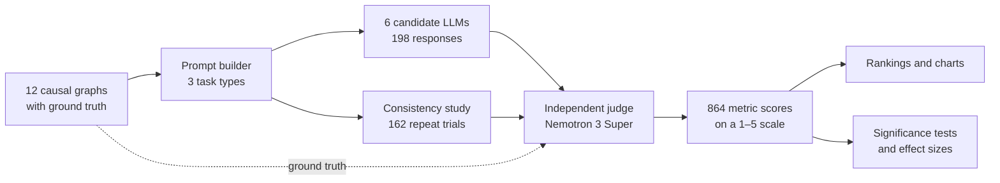
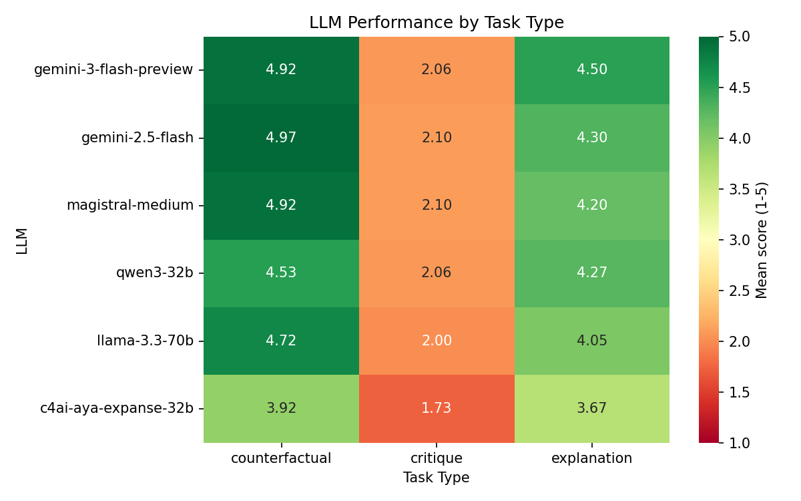
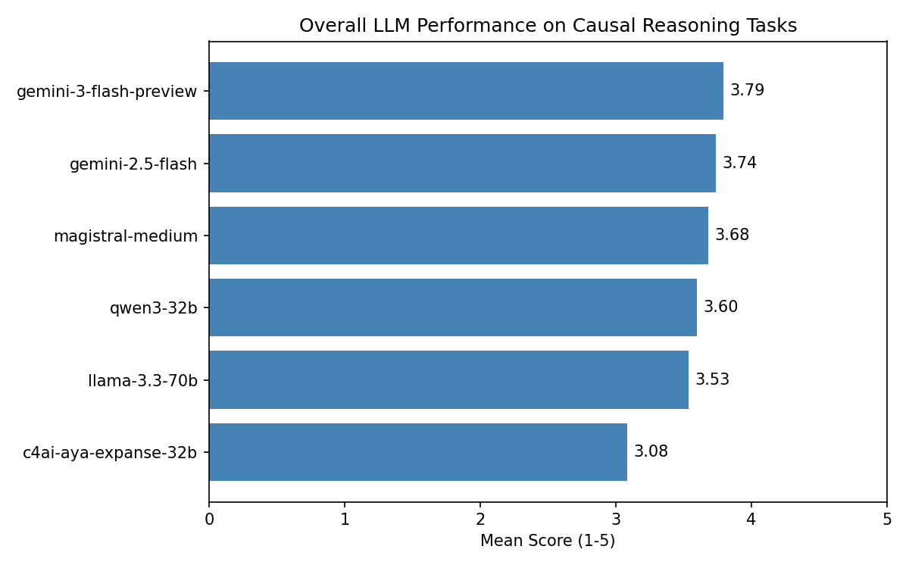
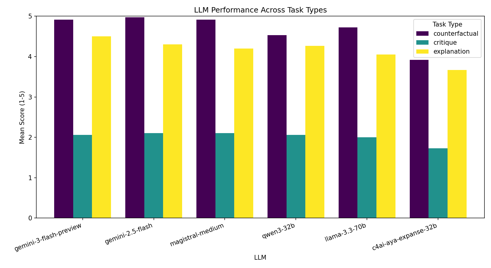

<p align="center">
  
</p>

<h1 align="center">Causal AI × LLM Explainability</h1>

<p align="center">
  <b>Can an LLM turn a causal graph into something a decision-maker can use,<br>and can it tell when that graph is wrong?</b>
</p>

<p align="center">
  
  
  
  
  
</p>

<p align="center">
  <a href="#key-findings">Key findings</a> ·
  <a href="#how-it-works">How it works</a> ·
  <a href="#results">Results</a> ·
  <a href="#reproduce-it">Reproduce it</a> ·
  <a href="#limitations">Limitations</a>
</p>

---

Causal AI systems output a graph of what influences what. The people who act on those findings, such as doctors, managers and operations leads, usually don't read causal graphs. LLMs could translate for them, but only if they stay faithful to the graph and notice when it is wrong.

This benchmark tests that. Six LLMs each completed three tasks across 12 causal graphs, and an independent LLM judge scored every response against each graph's ground truth. Some graphs were broken on purpose.

It is the code and data behind my B.Sc. Computer Science thesis at Constructor University Bremen, supervised by Prof. Dr.-Ing. Hendro Wicaksono and done in collaboration with Insytes GmbH, the company behind the Cauza causal AI platform.

## Key findings

| | Finding | Evidence |
|---|---|---|
| ✅ | **LLMs translate well** | Counterfactual tasks averaged **4.66 / 5**, explanations **4.16 / 5** |
| 🤝 | **The top five are effectively tied** | `gemini-3-flash-preview` ranks first, but no pair among the top five differs significantly (all p ≥ 0.23) |
| 🔎 | **Blatant errors get caught** | Five of six models scored 5 / 5 on detecting both the reversed and the spurious edge |
| 🕳️ | **Hidden confounders slip through** | On the missing-confounder graph, no model scored above 3 / 5 on detection |
| ⚠️ | **Correct graphs rarely get signed off** | None of the 54 critiques of correct graphs scored above 2 / 5 on detection ([read the caveat](#critique-the-hard-part)) |

## How it works



### The graphs

Difficulty rises across three levels. Level 3 uses the classic Asia medical network, plus three copies with one flaw planted in each.

| Level | Graphs | Size | What it tests |
|---|---|---|---|
| **L1** | 4 | 3 variables | One core pattern: chain, fork, collider, mediation |
| **L2** | 4 | 4–5 variables | Combined patterns, such as confounder + mediator and fork + collider |
| **L3** | 4 | 8 variables | A complex correct graph, plus reversed, spurious and missing-confounder versions |

<details>
<summary><b>See all 12 graphs</b></summary>

| Graph | Level | Pattern | Domain |
|---|---|---|---|
| [`L1_smoking_cancer`](data/dags/L1_smoking_cancer.json) | 1 | Chain | Health |
| [`L1_icecream_drowning`](data/dags/L1_icecream_drowning.json) | 1 | Fork | Everyday |
| [`L1_talent_luck_fame`](data/dags/L1_talent_luck_fame.json) | 1 | Collider | Social |
| [`L1_exercise_weight_health`](data/dags/L1_exercise_weight_health.json) | 1 | Mediation | Health |
| [`L2_climate_crops`](data/dags/L2_climate_crops.json) | 2 | Parallel mediators | Environment |
| [`L2_education_income_health`](data/dags/L2_education_income_health.json) | 2 | Confounder + mediator | Social |
| [`L2_marketing_sales`](data/dags/L2_marketing_sales.json) | 2 | Multi-path | Business |
| [`L2_study_grades_scholarship`](data/dags/L2_study_grades_scholarship.json) | 2 | Fork + collider | Education |
| [`L3_asia_correct`](data/dags/L3_asia_correct.json) | 3 | Complex multi-path with collider | Medical |
| [`L3_asia_broken_reversed`](data/dags/L3_asia_broken_reversed.json) | 3 | Broken: reversed causality | Medical |
| [`L3_asia_broken_spurious`](data/dags/L3_asia_broken_spurious.json) | 3 | Broken: spurious edge | Medical |
| [`L3_asia_broken_missing`](data/dags/L3_asia_broken_missing.json) | 3 | Broken: missing confounder | Medical |

</details>

### The tasks

Every prompt addresses an experienced professional in the graph's domain who doesn't know causal modelling.

| Task | The LLM is asked to | Graphs | Scored on |
|---|---|---|---|
| **Explanation** | Report the findings in plain language | 12 | Structural accuracy, pattern recognition, completeness, clarity, faithfulness |
| **Counterfactual** | Work out what changes, and what doesn't, after an intervention | 9 correct | Direction, scope, mechanism, causal reasoning |
| **Critique** | Give an honest second opinion on the graph | 12 | Flaw detection, flaw classification, false-positive avoidance, explanation quality |

### The models

| Model ID in this repo | Role | Accessed through |
|---|---|---|
| `gemini-3-flash-preview` | Candidate | Google Gemini API |
| `gemini-2.5-flash` | Candidate | Google Gemini API |
| `llama-3.3-70b` | Candidate | Groq |
| `qwen3-32b` | Candidate | Groq |
| `magistral-medium` | Candidate | Mistral |
| `c4ai-aya-expanse-32b` | Candidate | Cohere |
| `nemotron-3-super` | Judge, never evaluated | NVIDIA API |

## Results

### Leaderboard

| Model | Overall | Explanation | Counterfactual | Critique | Run-to-run SD |
|---|---:|---:|---:|---:|---:|
| `gemini-3-flash-preview` | **3.79** | **4.50** | 4.92 | 2.06 | **0.18** |
| `gemini-2.5-flash` | 3.74 | 4.30 | **4.97** | **2.10** | 0.36 |
| `magistral-medium` | 3.68 | 4.20 | 4.92 | **2.10** | 0.22 |
| `qwen3-32b` | 3.60 | 4.27 | 4.53 | 2.06 | 0.44 |
| `llama-3.3-70b` | 3.53 | 4.05 | 4.72 | 2.00 | 0.22 |
| `c4ai-aya-expanse-32b` | 3.08 | 3.67 | 3.92 | 1.73 | 0.25 |

<sub>Scores run from 1 to 5. Overall is the mean of each model's 144 metric scores. Run-to-run SD comes from the consistency study, and lower is steadier. Bold marks the best value in each column.</sub>

<p align="center">
  
</p>

<details>
<summary><b>More charts</b></summary>
<br>
<p align="center">
  
  
</p>
</details>

### Do the differences hold up?

Only partly. The ranking looks like a ladder, but the statistics describe two groups.

- **Overall difference:** a Friedman test finds that the models do not perform equally (χ² = 62.22, p < 0.001, 144 blocks).
- **Top five:** all 10 pairs are non-significant (Mann-Whitney U, p ≥ 0.23) with negligible effect sizes (|δ| ≤ 0.07).
- **`c4ai-aya-expanse-32b`:** it scores lower than every other model at p < 0.05, with small effect sizes (|δ| 0.15–0.23). Three of those five gaps survive Bonferroni correction across the 15 comparisons, against both Gemini models and `magistral-medium`.

### Explanation: clear, but incomplete

Models rarely distorted a graph. They often left out what the ground truth expected them to point out.

| Metric | Mean score |
|---|---:|
| Clarity | 4.96 |
| Structural accuracy | 4.78 |
| Faithfulness | 4.78 |
| Pattern recognition | 3.54 |
| Completeness | 2.76 |

### Critique: the hard part

Critique averaged **2.01**, but that number hides two very different stories. Flaw detection shows them:

| Graph type | Graphs | Critiques | Mean flaw detection |
|---|---:|---:|---:|
| Reversed edge | 1 | 6 | 4.33 |
| Spurious edge | 1 | 6 | 4.33 |
| Missing confounder | 1 | 6 | 2.17 |
| Correct, no planted flaw | 9 | 54 | 1.07 |

On broken graphs, models spotted what was on the page. Every model except `c4ai-aya-expanse-32b` scored 5 / 5 on the reversed and spurious edges. Noticing an absent variable was much harder.

> [!IMPORTANT]
> The 1.07 is not simply a sign that LLMs invent errors. The critique prompt asks which important factors are missing, while the ground truth for these graphs lists no flaws, so the judge counts any suggested addition as a false positive. Some of those suggestions are medically reasonable, such as a direct link from smoking to death. A fairer reading is that LLMs almost never declare a graph complete.

### Consistency

Each of 54 conditions (3 graphs × 6 models × 3 tasks) ran three times, giving 162 scored trials. The mean within-condition standard deviation was **0.28** on the 5-point scale, and explanation was the steadiest task (0.18).

The largest swing, `qwen3-32b` on the smoking counterfactual (SD 2.31), comes from output failure rather than unstable reasoning: two of its three responses were cut off during generation.

### Prompt design changed the study

The first round showed that the prompts themselves were a problem: models spent tokens explaining what a causal graph is. So the prompts were rewritten and the evaluation was run again.

| | v1: generic | v2: refined |
|---|---|---|
| **Audience** | "Non-expert manager" | Experienced professional in the domain, new to causal modelling |
| **Vocabulary** | No explicit rule | Bans "node", "edge" and "DAG", and uses "factors" and "links" instead |
| **Format** | Tutorial | Report with direct findings and no preamble |

All results above come from v2. The v1 data lives in the `*_v1_generic_prompt` folders, and the reasoning is in [`notes/prompt_v2_changes.md`](notes/prompt_v2_changes.md).

## Reproduce it

### Rebuild the analysis, no API keys needed

All raw responses and scores are committed, so the rankings, charts and statistics can be regenerated offline.

```bash
git clone https://github.com/AliHanouch03/causal-ai-llm-explainability.git
cd causal-ai-llm-explainability
python -m venv .venv && source .venv/bin/activate
pip install pandas scipy matplotlib seaborn

python scripts/analyze_results.py
python scripts/statistical_analysis.py
python scripts/analyze_consistency.py
```

Outputs land in [`data/analysis/`](data/analysis/).

### Run the full benchmark

This calls five paid or rate-limited APIs. Install the clients:

```bash
pip install google-genai groq mistralai cohere openai python-dotenv
```

Then create `src/.env`:

```ini
GEMINI_API_KEY=...
GEMINI_API_KEY_2=...   # optional, keys are rotated to spread quota
GEMINI_API_KEY_3=...   # optional
GROQ_API_KEY=...
MISTRAL_API_KEY=...
COHERE_API_KEY=...
NVIDIA_API_KEY=...
```

And run the pipeline:

```bash
python scripts/run_evaluation.py     # generate responses
python scripts/score_results.py      # judge them
python scripts/consistency_study.py  # repeat trials
python scripts/score_consistency.py  # judge the repeats
```

> [!NOTE]
> The pipeline is resumable: finished work is skipped. To start from scratch, move the existing files out of `data/results/`, `data/scores/` and `data/consistency/` first. Provider model IDs change over time, so you may need to update the registry in `src/llm_clients.py`.

## Repository layout

```text
├── src/
│   ├── dag_loader.py                    # Load graphs and turn them into text
│   ├── llm_clients.py                   # Provider clients and model registry
│   └── tasks.py                         # Prompts for the three tasks
├── scripts/
│   ├── run_evaluation.py                # Run every LLM on every task
│   ├── score_results.py                 # LLM judge, metrics and JSON parsing
│   ├── analyze_results.py               # Rankings and charts
│   ├── statistical_analysis.py          # Friedman, Mann-Whitney U, Cliff's delta
│   ├── consistency_study.py             # Repeat trials
│   ├── score_consistency.py             # Judge the repeats
│   ├── analyze_consistency.py           # Variance across trials
│   ├── sample_for_manual_validation.py  # Sample responses for human rating
│   └── compare_manual_vs_judge.py       # Human vs judge agreement
├── data/
│   ├── dags/                            # 12 graphs with ground truth
│   ├── results/                         # Raw LLM responses
│   ├── scores/                          # Judge scores and justifications
│   ├── consistency/                     # Repeat trials and their scores
│   ├── analysis/                        # Final tables and charts
│   ├── manual_validation/               # Sampled responses for human rating
│   └── *_v1_generic_prompt/             # First-round prompt iteration
├── notes/                               # Prompt design notes
└── tests/                               # API smoke tests
```

## Limitations

- **One LLM judge:** every score comes from a single model. [`data/manual_validation/`](data/manual_validation/) holds a stratified sample of 30 responses, and `compare_manual_vs_judge.py` measures agreement, but the committed sheets contain no human ratings yet. The judge is therefore unvalidated in this repo.
- **Closed-world ground truth:** the judge scores against listed flaws, which penalises reasonable critiques of correct graphs, as described [above](#critique-the-hard-part).
- **One graph per flaw type:** each flaw appears once, so these results rest on six critiques each.
- **One truncated response:** of the 198 main-run responses, `qwen3-32b` on the `L2_climate_crops` counterfactual was cut off mid-reasoning and scored 1 on all four metrics. A perfect score there would add at most 0.11 to its overall mean, which does not change the top-five tie.
- **A scoring rule on broken graphs:** false-positive avoidance is fixed at 5 on broken graphs, where it does not apply. The critique analysis above uses flaw detection for that reason.
- **v1 is not comparable:** the v1 leaderboard mixes two judges (`llama-3.3-70b` and `nemotron-3-super`), so use it to study the prompt change, not to rank models.

## Author

**Ali Hanouch** · [LinkedIn](https://www.linkedin.com/in/ali-hanouch)
